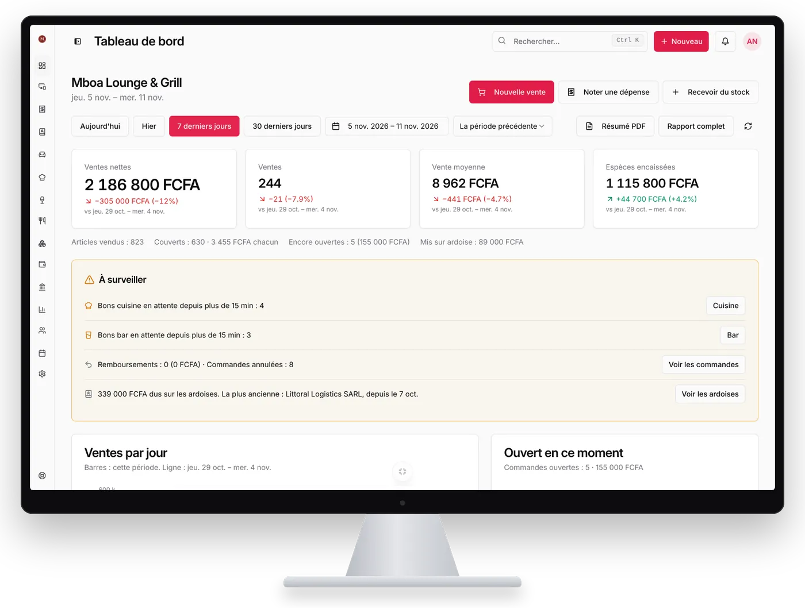
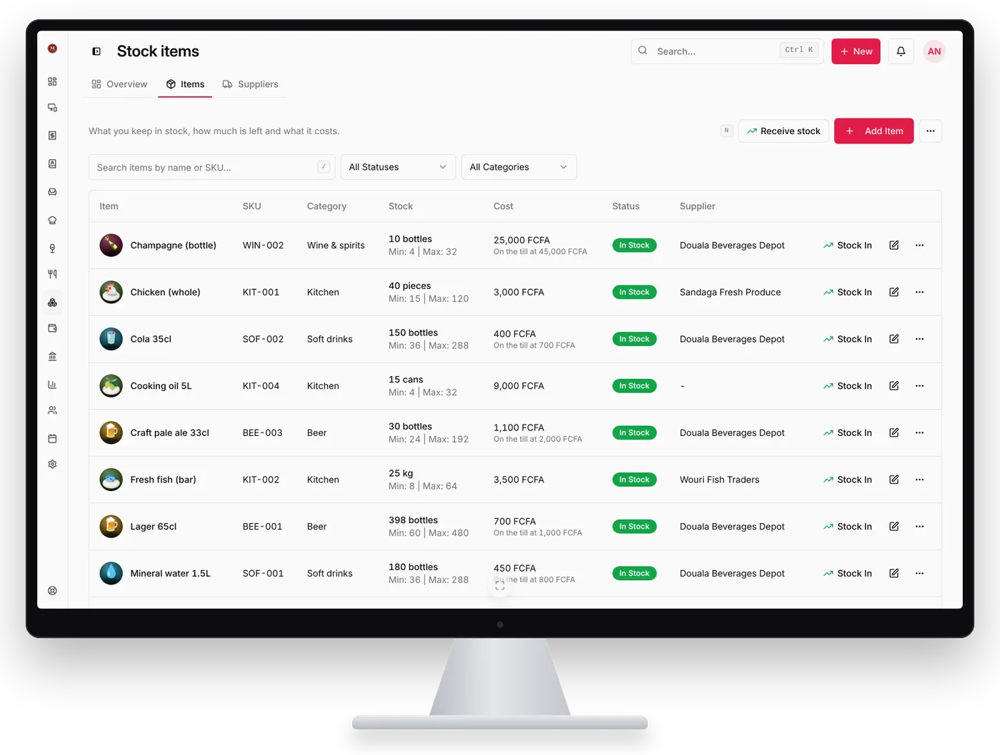
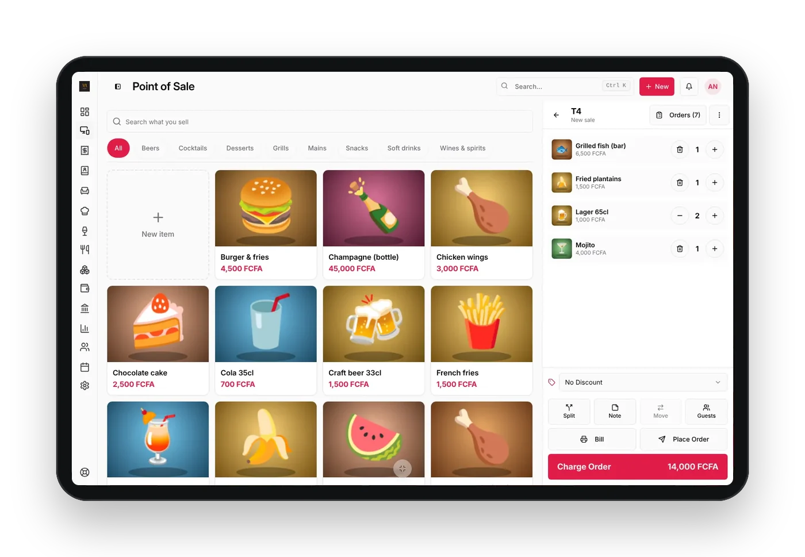
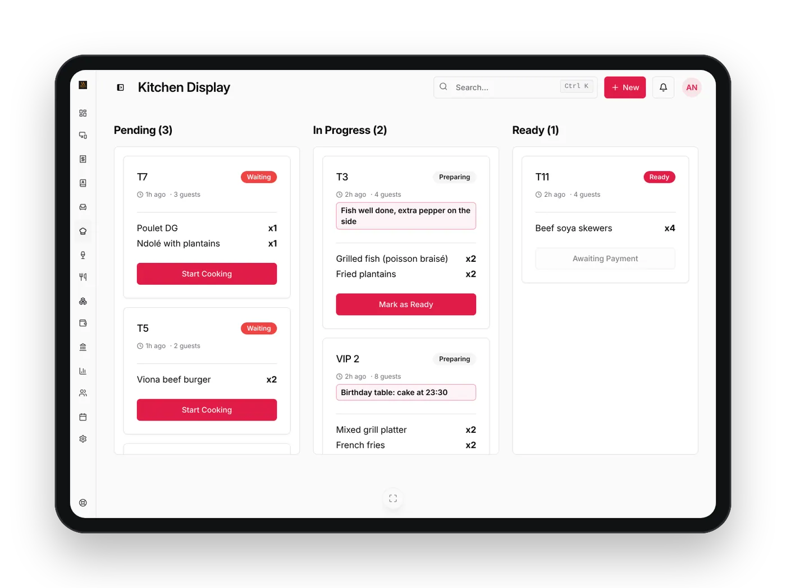
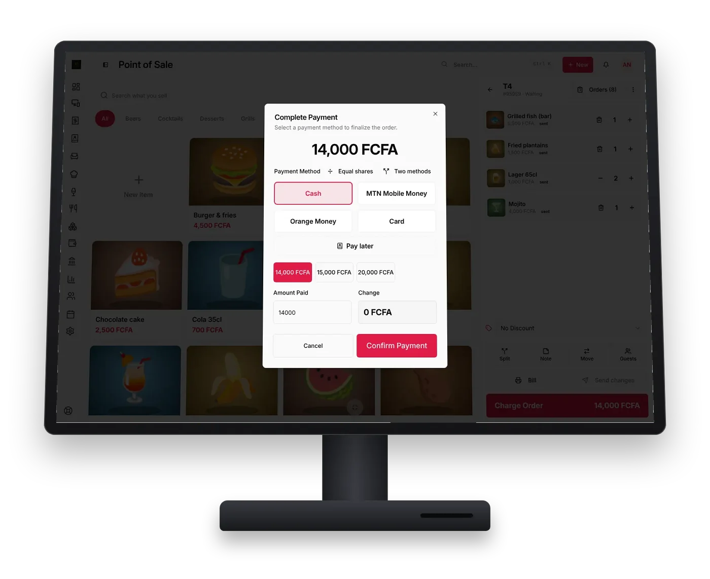
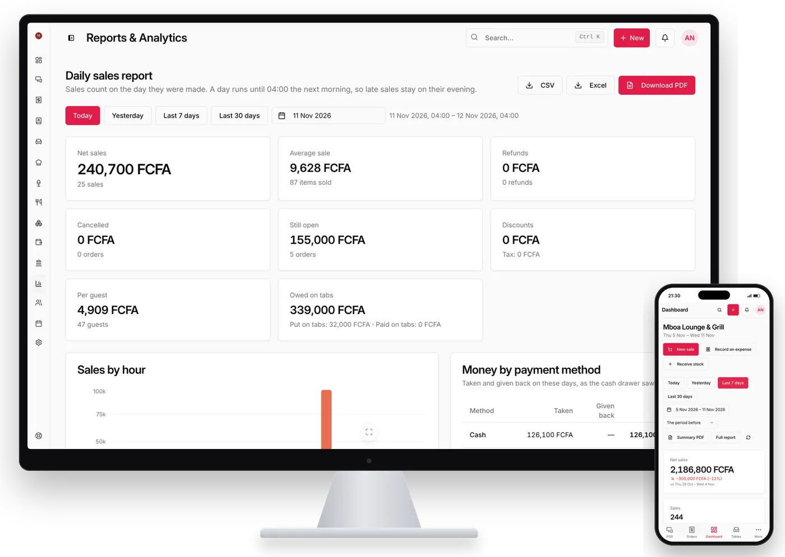

**LoungeOS** est un logiciel de caisse (point de vente) et de gestion pour tous les commerces qui vendent : restaurants, snack-bars, bars, lounges, boîtes de nuit, maquis, fast-foods, hôtels, boutiques, supermarchés et bien d'autres. Vous l'utilisez dans n'importe quel navigateur récent sur [app.loungeos.app](https://app.loungeos.app/login), ou avec les applications Windows, Mac et Android. Un seul compte LoungeOS suffit partout.

## Ce que LoungeOS règle pour vous

  
<h3>Les coupures d'internet</h3>
Sur Windows et Mac, la caisse continue de vendre sans internet et se synchronise dès que la connexion revient.

  
<h3>Les vols et les « oublis »</h3>
Chaque employé a son rôle et ses permissions, et le journal d'activité enregistre chaque action avec un nom.

  
<h3>Les bons perdus en cuisine</h3>
Les plats s'affichent sur l'écran cuisine, les boissons sur l'écran bar.

  
<h3>Les stocks qui ne collent pas</h3>
Chaque mouvement de stock est enregistré, et une alerte vous prévient avant la rupture.

  
<h3>Mobile Money</h3>
Créez vos propres moyens de paiement : espèces, MTN Mobile Money, Orange Money, carte, virement…

  
<h3>Les dépenses et la comptabilité</h3>
Dépenses classées dans vos propres catégories, plan comptable et journal, rapports clairs.

## Prêt dès le premier jour

1. **Créez votre compte** sur [app.loungeos.app](https://app.loungeos.app/login) avec votre e-mail et un mot de passe, ou cliquez sur **Continuer avec Google**. L'inscription se trouve sur la page de connexion.
2. **Répondez à l'assistant de configuration** : type d'activité, nom, logo, devise, taxes, moyens de paiement et horaires d'ouverture.
3. **Cochez les catégories proposées** pour votre menu, vos stocks et vos dépenses. LoungeOS est configuré dès le premier jour.
4. **Utilisez LoungeOS où vous travaillez** : dans l'application web, ou installez l'application Windows, Mac ou Android et connectez-vous avec le même compte. Aucune clé, aucun code à copier.
5. **Invitez votre personnel** par e-mail et donnez un rôle à chacun. Sur une caisse partagée, chacun change d'utilisateur avec un code PIN rapide.

## Une soirée au Viona Lounge

Viona Lounge est un restaurant, bar et lieu de rencontre chaleureux à Tarred Malingo, Buea, et il tourne sur LoungeOS. Suivez une soirée là-bas, de l'ouverture à la fermeture. Les chiffres et les noms du personnel sur ces écrans sont des données d'exemple, pas les vrais comptes de Viona. Chaque écran ci-dessous est LoungeOS tel qu'il est aujourd'hui.

<article class="story-chapter">

16 h · Avant l'ouverture
<h3>La patronne lit la semaine en un coup d'œil</h3>
Amina ouvre le tableau de bord sur son ordinateur : ventes nettes, nombre de ventes, panier moyen et encaissements, comparés à la semaine d'avant. Juste en dessous, ce qui demande son attention : les articles presque épuisés, les tickets qui attendent trop et l'argent encore dû sur les comptes clients.
<ul class="story-points"><li>Le même compte dans le navigateur et les applications Windows, Mac et Android</li><li>Le résumé PDF de la journée en un geste</li></ul>
<figure class="story-figure"></figure></article>
<article class="story-chapter story-flip">

17 h 30 · La livraison de bières
<h3>Un stock qui correspond aux étagères</h3>
Le gestionnaire de stock coche ce qui est arrivé, saisit les quantités et les coûts du bon de livraison, et les chiffres sont justes avant le service. Chaque vente les diminue, chaque mouvement est enregistré avec un nom, et les articles bas sont signalés avant la rupture.
<ul class="story-points"><li>Toute une livraison en une fois</li><li>Fournisseurs, codes-barres et alertes de stock bas</li></ul>
<figure class="story-figure"></figure></article>
<article class="story-chapter">

20 h · Les tables se remplissent
<h3>La commande se prend à table</h3>
Un anniversaire de huit personnes s'installe au VIP 2. Grace ouvre la table sur sa tablette et touche les photos : le plateau de grillades, une bouteille de champagne, trois cocktails maison. Chaque plat a sa photo, un nouveau serveur le trouve en une seconde.
<ul class="story-points"><li>Au toucher ou à la souris, du téléphone au grand écran de caisse</li><li>Une photo pour chaque produit, scan des codes-barres en boutique</li></ul>
<figure class="story-figure"></figure></article>
<article class="story-chapter story-flip">

20 h 01 · Cuisine et bar
<h3>Plus aucun bon perdu</h3>
Les plats s'affichent sur l'écran cuisine et les boissons sur l'écran bar, avec les notes du serveur en rouge : « poisson bien cuit, piment à part ». Le cuisinier appuie sur Commencer, puis Prêt, et le serveur est prévenu. Si la table ajoute un plat, le ticket n'affiche que ce qui a changé.
<ul class="story-points"><li>Écrans cuisine et bar sur n'importe quelle tablette ou ordinateur</li><li>Tickets imprimés en 58 ou 80 mm si vous préférez le papier</li></ul>
<figure class="story-figure"></figure></article>
<article class="story-chapter">

22 h 30 · L'addition
<h3>Espèces, Mobile Money, partagée ou sur le compte</h3>
À la caisse, Carine encaisse la table 3 : moitié en espèces, moitié en MTN Mobile Money avec sa référence. La table suivante partage l'addition en parts égales, et un habitué met la sienne sur son compte pour payer en fin de mois. Le reçu s'imprime et le tiroir-caisse s'ouvre.
<ul class="story-points"><li>Espèces, MTN Mobile Money, Orange Money, carte et vos propres moyens, en FCFA</li><li>Partage, changement de table, paiement plus tard, reçus 58 et 80 mm</li></ul>
<figure class="story-figure"></figure></article>
<article class="story-chapter story-flip">

4 h · La journée se ferme
<h3>Chaque vente, chaque franc, chaque nom</h3>
Le rapport du jour détaille la nuit par heure, produit, serveur et moyen de paiement, en PDF, Excel ou CSV. Les dépenses vont dans leurs catégories, la comptabilité se tient toute seule, et le journal d'activité montre qui a annulé quoi et pourquoi. Amina le consulte sur son téléphone le lendemain matin.
<ul class="story-points"><li>Dépenses, plan comptable, compte de résultat</li><li>Rôles, codes PIN, validation du gérant et journal d'activité</li></ul>
<figure class="story-figure"></figure></article>

Dans une boutique ou un supermarché, tout se passe à la caisse : vous scannez ou touchez les articles, vous encaissez et vous imprimez le reçu.

## Vendre même sans internet

Les applications **Windows et Mac** gardent les données de votre établissement sur l'ordinateur. Si internet coupe, la caisse continue de vendre, et tout se synchronise automatiquement au retour de la connexion. Les téléphones et tablettes connectés au même Wi-Fi peuvent continuer à utiliser l'application de l'ordinateur depuis leur navigateur.

Après 7 jours sans synchronisation, la caisse passe en lecture seule jusqu'à ce qu'elle se reconnecte. Un avertissement s'affiche pendant les 2 derniers jours. En lecture seule, les commandes passées, les rapports, l'impression et les exports fonctionnent toujours.

L'application web et l'application Android ont besoin d'internet. Pendant une coupure de courant, un petit onduleur sur l'ordinateur (et sur le routeur si vos téléphones s'y connectent) suffit pour continuer.

## Où fonctionne LoungeOS

- **Windows** 10 et 11 (64 bits) : vente hors ligne et synchronisation
- **Mac** Apple Silicon (M1 et suivants) et Intel : vente hors ligne et synchronisation
- **Android** 6.0 ou plus récent, avec Google Chrome et internet
- **Application web** sur [app.loungeos.app](https://app.loungeos.app/login), dans n'importe quel navigateur récent, sans rien installer

Toutes les applications et les liens de téléchargement sont sur la page [Télécharger](/fr/telecharger/).

## Tarifs

[[include:plans]]

Vous payez par Mobile Money (MTN, Orange), carte ou PayPal sur [account.loungeos.app](https://account.loungeos.app), où vous gérez aussi votre formule et vos factures. Voir tous les [tarifs](/fr/tarifs/).

## LoungeOS dans votre pays

- [Cameroun](/fr/cameroun/) : FCFA, MTN MoMo, Orange Money, TVA 19,25 %
- [Côte d'Ivoire](/fr/cote-divoire/) : maquis, restaurants, lounges et commerces d'Abidjan
- [Sénégal](/fr/senegal/) : restaurants, dibiteries et commerces de Dakar
- [Afrique francophone](/fr/afrique/) : tous les pays de la zone FCFA et au-delà

## Questions fréquentes

### LoungeOS fonctionne-t-il vraiment sans internet ?

Oui, avec les applications Windows et Mac. Elles gardent vos données sur l'ordinateur, continuent de vendre sans internet et se synchronisent automatiquement au retour de la connexion. Après 7 jours sans synchronisation, la caisse passe en lecture seule jusqu'à ce qu'elle se reconnecte. L'application web et l'application Android ont besoin d'internet.

### Sur quels appareils fonctionne LoungeOS ?

Dans n'importe quel navigateur récent, et avec les applications Windows 10 et 11 (64 bits), Mac (Apple Silicon et Intel) et Android 6.0 ou plus récent. Vous utilisez le même compte LoungeOS partout. Voir la page [Télécharger](/fr/telecharger/).

### Combien coûte LoungeOS ?

Au Cameroun : Starter à 6 000 FCFA par mois, Business à 15 000 FCFA et Pro à 30 000 FCFA. Ailleurs : 10, 25 ou 50 $ US par mois. En payant à l'année, vous avez 2 mois offerts (60 000, 150 000 ou 300 000 FCFA par an). Chaque formule commence par un essai gratuit de 14 jours avec les fonctionnalités Business, sans paiement à l'avance.

### Comment commencer ?

Créez votre compte sur [app.loungeos.app](https://app.loungeos.app/login) avec votre e-mail et un mot de passe, ou avec **Continuer avec Google**. L'assistant de configuration vous demande votre type d'activité, votre nom, votre logo, votre devise, vos taxes, vos moyens de paiement et vos horaires, puis vous propose des catégories à cocher. Dans les applications Windows, Mac et Android, il suffit de vous connecter avec le même compte.

### Que se passe-t-il si mon abonnement se termine ?

LoungeOS passe en lecture seule, sur le web comme sur vos caisses, jusqu'au renouvellement. Vous consultez toujours les commandes passées et les rapports, vous pouvez imprimer et exporter. Rien n'est jamais supprimé.

### Le logiciel est-il en français ?

Oui. L'interface de LoungeOS est disponible en français et en anglais.

### Quel matériel faut-il ?

Les appareils que vous avez déjà : un ordinateur Windows ou Mac, un téléphone ou une tablette Android, ou tout appareil avec un navigateur récent. Les reçus s'impriment sur une imprimante thermique 58 mm ou 80 mm, ou en PDF.

### Combien d'appareils puis-je connecter ?

Cela dépend de votre formule : 2 utilisateurs et 2 appareils avec Starter, 5 utilisateurs et 5 appareils avec Business, utilisateurs illimités et 10 appareils et plus avec Pro.

### Mes données sont-elles en sécurité ?

Oui. Toutes vos données ont une copie dans le cloud, avec une sauvegarde complète chaque jour. Les logos, images et documents que vous ajoutez sont stockés en sécurité dans le cloud. Chaque employé ne voit que ce que son rôle lui permet.
